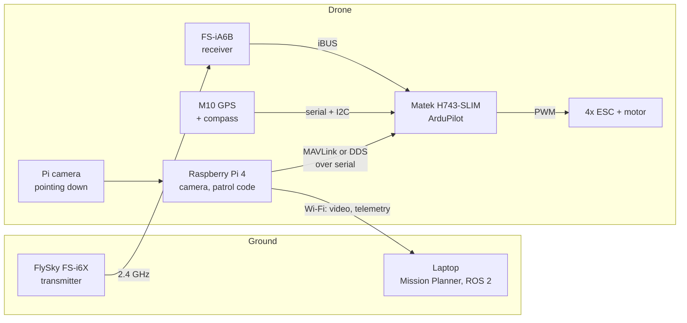

# Drone Autonomy

A quadcopter I'm building from parts, with ArduPilot on the flight controller and a Raspberry Pi on board running my own code. This repo is the build log: what I bought and why, how I set every piece up, what went wrong, and the code.

**Where it's going:** an autonomous patrol. The drone sweeps an area in a lawnmower pattern until its camera spots a specific target, works out the target's GPS position, and reports it. The first version already runs end to end in the simulator ([patrol/](patrol/)).

## Status

| Stage | What it covers | Status |
|---|---|---|
| Parts | Ordering, checking, batteries | Done, waiting on the charger |
| Simulator | Ubuntu, ArduPilot SITL, Mission Planner, first scripts | Not started |
| Flight controller | Firmware, radio, GPS, failsafes | Not started |
| Assembly | Frame, power, ESCs, wiring | Not started |
| ROS 2 | ROS 2 Humble, ArduPilot's DDS interface | Not started |
| First flights | Hover, Loiter, RTL, log review | Not started |
| Companion computer | Pi on board, MAVLink and DDS over serial, video | Not started |
| Project | Patrol and search | Works in SITL; real camera not tested |

*Update this table as you go. It's the first thing anyone sees.*

## How it fits together



The flight controller flies the drone. The Pi decides where it should go. The pilot can take control back at any moment with the mode switch.

## The docs, in build order

1. [Goals and plan](docs/01-goals-and-plan.md): what this is for and the order things happen in
2. [Hardware](docs/02-hardware.md): every part, what it cost, and why it was chosen
3. [Safety and the rules in Israel](docs/03-safety-and-rules.md)
4. [Development environment](docs/04-dev-environment.md): Ubuntu, the simulator, Mission Planner, ROS 2
5. [Flight controller setup](docs/05-flight-controller.md): firmware, radio, failsafe, GPS
6. [Assembly and wiring](docs/06-assembly-and-wiring.md)
7. [First flights](docs/07-first-flights.md)
8. [Companion computer](docs/08-companion-computer.md): the Pi on board
9. [The project: patrol and search](docs/09-project-patrol-search.md)

Also: [decisions](docs/decisions/) (why I chose what I chose) and the [build journal](docs/journal/).

## Repo layout

```
docs/            how everything was set up, in build order, plus decisions and journal
hardware/        wiring diagram, photos, 3D-printed parts
params/          ArduPilot parameter files, saved at each milestone
scripts/sitl/    small MAVLink scripts for learning against the simulator
patrol/          the project: coverage planner, detectors, mission state machine, tests
companion/       scripts that run on the Raspberry Pi
ros2_ws/         ROS 2 workspace (later)
```

## Try the project in the simulator

With ArduPilot SITL installed ([docs/04](docs/04-dev-environment.md)):

```bash
# terminal 1: the simulated drone, with an extra MAVLink output for scripts
sim_vehicle.py -v ArduCopter --console --map --out=udp:127.0.0.1:14551

# terminal 2: the patrol, with a pretend target hidden in the test field
cd patrol
pip install -r requirements.txt
python3 -m patrol.run --area areas/sitl_field.json --sim-target=-35.36302,149.16560
```

The drone takes off, sweeps the field, spots the target, flies over it, prints its position and comes home.

## Hardware at a glance

ArduPilot Copter 4.7 on a Matek H743-SLIM V3 · S500 frame · 2212 920KV motors on 10x4.5 props · 3S 5000 mAh LiPo · FlySky FS-i6X with FS-iA6B (iBUS) · M10 GPS with compass · Raspberry Pi 4 (4 GB) with Pi camera · about 1.4 kg flying weight. Full list in [docs/02-hardware.md](docs/02-hardware.md).

## Working on this repo

```bash
git pull                      # get the latest (if you edited on GitHub or another machine)
# ...edit docs, add photos, write code...
git add -A
git commit -m "Wire receiver; radio calibration done"
git push
```

Small, frequent commits with plain messages make a better history than one big one. Photos go in `hardware/photos/`; keep them under about 1 MB each.
