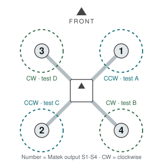

# 6. Assembly and wiring

Building the frame, the power system and the wiring, then proving it all works with the props off.

Status: not started

## 6.1 Frame

1. Motors onto the arms. Check the motor screws don't reach the windings: a screw that's too long shorts the motor. Use a drop of blue (medium) threadlocker.
2. Arms between the top and bottom plates. The PCB plate is the bottom one.
3. Landing gear.
4. Mark the front with coloured tape. Everything else is oriented from it.

Motor positions (from above, front at the top):

| Matek output | Position | Spin | Motor Test letter |
|---|---|---|---|
| S1 | front right | counter-clockwise | A |
| S4 | rear right | clockwise | B |
| S2 | rear left | counter-clockwise | C |
| S3 | front left | clockwise | D |

## 6.2 Power system

All soldered to the PCB plate's main + and − pads:

- the four ESC power leads
- the **male** XT60 pigtail (12 AWG)
- a lead to the Matek's VBAT and G pads
- the UBEC's input

The power module sits inline between the battery and that XT60: battery (female) → power module (male in, female out) → pigtail (male).

Soldering tips: tin the pad and the wire first, use a big tip and enough heat that the solder flows in a couple of seconds, and heat-shrink every joint.

**Check before any battery goes near it:**
- Continuity between the XT60's + and − must **not** beep.
- Each ESC's red goes to +, black to −.

## 6.3 Signals and sensors

| From | To | Note |
|---|---|---|
| ESC signal + ground, ×4 | Matek S1-S4 and G, in motor order | Cut back each ESC's red BEC wire and heat-shrink it. Four ESC BECs shouldn't fight the Matek's own 5 V |
| Power module current wire + ground | Matek Curr and G | The usual APM-style 6-pin order is 5V, 5V, current, voltage, GND, GND, but check the module's label. Voltage and 5 V wires unused |
| Receiver iBUS | RX6, 4.5 V, G | From [section 5.4](05-flight-controller.md#54-receiver) |
| GPS | RX2/TX2, 4.5 V, G, SDA/SCL | From [section 5.7](05-flight-controller.md#57-gps-and-compass) |

## 6.4 Mounting

- Matek on nylon standoffs with its soft grommets, arrow pointing forward.
- GPS on a mast about 10 cm up (3D-printed, in [hardware/prints](../hardware/prints/)), arrow forward, away from the power wires. The compass picks up interference from current.
- Receiver antennas at 90° to each other, away from carbon and metal.
- Battery under the frame on the strap, centred so the drone balances on its middle.

## 6.5 First power-up

Battery → smoke stopper → power module → drone. A battery at storage charge is fine.

**Check:**
- The smoke stopper doesn't light up hard. If it does, unplug and find the short.
- The ESCs play their startup tones and the Matek boots.
- Mission Planner's battery voltage is within 0.1 V of the multimeter on the battery. If not, adjust `BATT_VOLT_MULT`: new = old × (meter ÷ Mission Planner).

## 6.6 UBEC for the Pi

Set the jumper to **5 V**. With the battery in, measure the output: it must read 5.0-5.25 V. Write "5V OK" on it with a marker. 6 V on the Pi's 5 V pins kills the Pi.

## 6.7 ESC calibration

These are PWM ESCs, so they have to learn the throttle range. Props off, USB unplugged. From [ArduPilot's method](https://ardupilot.org/copter/docs/esc-calibration.html):

1. Transmitter on, throttle stick to the top.
2. Plug in the battery. The LEDs cycle: the board is ready to calibrate.
3. Unplug the battery and plug it back in, throttle still at the top.
4. The ESCs play a tone, beep three times (3 cells), then twice more.
5. Throttle stick to the bottom. A long tone means it's done.
6. Raise the throttle a little: all four motors should start together. Throttle down, unplug.

**Check:** all four motors start at the same throttle.

## 6.8 Motor order and direction

Props off. Setup → Optional Hardware → Motor Test. Test motors A, B, C, D one at a time at about 10%.

**Check:** A is front right, B rear right, C rear left, D front left, and each spins the way the table in 6.1 says. If a motor spins the wrong way, swap any two of its three wires.

## 6.9 Compass calibration

Outdoors, away from cars and reinforced concrete, battery in. Setup → Mandatory Hardware → Compass → Onboard Mag Calibration → Start, then rotate the drone through every axis until it finishes. Reboot.

**Check:** the drone's heading in Mission Planner matches a phone compass within about 10°, pointing it north, east, south and west.

## 6.10 Armed failsafe test

Props off. From [ArduPilot's test](https://ardupilot.org/copter/docs/radio-failsafe.html):

1. Stabilize, arm with throttle at zero, transmitter off. **It should disarm.**
2. Arm again, raise throttle to mid, transmitter off. **The mode should change to RTL** (or Land with no GPS).
3. Transmitter back on, flip the mode switch away and back: I have control again.

## My notes

<!-- Photos of each stage, anything that didn't fit, soldering that went wrong. -->
