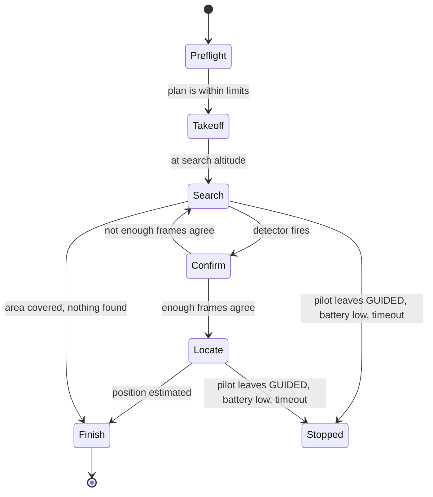

# 9. The project: patrol and search

**The idea:** give the drone an area. It sweeps the area on its own until its camera spots a specific target, works out where the target is on the map, and reports it. Then it comes home, or hovers over the target, or lands next to it.

This is the current idea. If I find a better one I'll change it; most of the pieces (flying from code, the camera, geolocation) carry over to other projects.

Status: works in the simulator with a simulated detector. Real camera and real flights not done yet.

## Why this project

It touches everything the build is for: planning a path, flying it from code, computer vision on a small computer, turning pixels into map coordinates, handling failures, and keeping the pilot in control. It's also a small version of a real job drones do: search and rescue, perimeter patrol, finding things in fields.

## Scope

**Version 1 (now):**
- A convex area given as GPS corners
- A lawnmower sweep at a fixed altitude and speed
- One kind of target: an ArUco marker (a printed black and white square)
- Confirm the target, fly over it, estimate its position, report it, then RTL / hover / land
- Runs the same code against SITL and the real drone

**Later:**
- Other targets: a coloured object, then a small neural network ("a person", "a car")
- Streaming the annotated video and the result to a web page or Android app
- A ROS 2 version: detector, planner and mission as separate nodes
- Precision landing on the target with ArduPilot's `LANDING_TARGET` support
- Smarter search: start where the target is most likely, or re-plan around obstacles

**Not doing:** flying beyond line of sight, above 45 m, or over people.

## How it works



| Piece | File | What it does |
|---|---|---|
| Geometry | `patrol/geo.py` | GPS to local metres and back (flat-earth, fine for a field) |
| Coverage | `patrol/coverage.py` | Camera footprint, lane spacing, lawnmower waypoints |
| Geolocation | `patrol/geolocate.py` | Pixel to ground position, using altitude and attitude |
| Detectors | `patrol/detector.py` | Simulated detector for SITL, ArUco detector for the real camera |
| Camera | `patrol/camera.py` | Pi camera, webcam, or none |
| Bench test | `patrol/bench.py` | Runs the detector on live frames, no flight controller needed |
| Vehicle | `patrol/vehicle.py` | pymavlink wrapper: state, modes, arming, go-to |
| Mission | `patrol/mission.py` | The state machine above |

### Lane spacing

A camera pointing down sees a rectangle of ground. Its width is `2 × altitude × tan(HFOV / 2)`. The Pi Camera v2's horizontal field of view is 62.2°, so:

| Altitude | Footprint | Lane spacing (30% overlap) | 0.5 m target in a 640 px image |
|---|---|---|---|
| 10 m | 12.1 × 9.1 m | 8.4 m | 27 px |
| 15 m | 18.1 × 13.6 m | 12.7 m | 18 px |
| 20 m | 24.1 × 18.1 m | 16.9 m | 13 px |
| 30 m | 36.2 × 27.2 m | 25.3 m | 9 px |

Detectors need roughly 15-20 pixels across a target, so higher means fewer lanes but a target that's too small to see. Version 1 searches at 15 m for a 50 cm marker. A bigger marker, or a higher camera resolution, allows a higher search.

### Confirming a detection

A single detection could be noise. The target counts as found when it shows up in 4 of the last 10 frames. Then the drone stops, flies over the first estimate, and keeps looking for a few seconds to refine it.

### Where is it on the map

For each detection: take the pixel, turn it into a direction from the camera, rotate it by the drone's roll, pitch and yaw, and see where that line hits flat ground at the drone's altitude. Then add that offset to the drone's GPS position. The final answer is the median of all the sightings.

In SITL the estimate lands within centimetres, because the simulated detector uses the same camera model. Real error will be more like 1-3 m: GPS error, lens distortion, timing between the camera frame and the attitude reading, and ground that isn't flat.

### Safety

- Refuses to start if the area reaches more than 250 m from home or the altitude is over 45 m.
- Refuses to arm a drone that's already armed (use `--wait-for-guided` to start mid-air).
- Stops sending commands the instant the mode isn't GUIDED: the pilot flipped a switch, or a failsafe kicked in.
- Returns home if the battery drops under 30% or the mission runs past 15 minutes.
- On the real drone, start with `--wait-for-guided`: I take off and climb in Loiter, then flip SwD to GUIDED to hand over.
- ArduPilot's own fence and failsafes stay on underneath all of this.

## Testing plan

| Stage | How | Status |
|---|---|---|
| Unit tests | `python3 -m pytest` in `patrol/`: geometry, coverage, geolocation round trips | Passing |
| SITL, simulated detector | `python3 -m patrol.run --area areas/sitl_field.json --sim-target=LAT,LON` | Works |
| SITL, pilot override | Switch modes mid-search: the script stops | Works |
| SITL, wait-for-guided | Take off in another tool, switch to GUIDED: the patrol starts | Works |
| Detector on the bench | Marker on the floor, camera 2 m above it: `python3 -m patrol.bench --camera pi --aruco 7 --height 2`. Checks detection, frame rate and the ground offset | |
| Detection-only flight | Fly over the marker in Loiter with the detector logging | |
| Full patrol, real drone | Small field, marker placed by a friend | |

## Running it

In SITL (see [section 4.2](04-dev-environment.md#42-ardupilot-sitl) for launching SITL with the extra output):

```bash
cd patrol
pip install -r requirements.txt
python3 -m patrol.run --area areas/sitl_field.json --sim-target=-35.36302,149.16560
```

On the drone, from the Pi:

```bash
python3 -m patrol.run --connect /dev/serial0 --baud 921600 \
    --area areas/my_field.json --camera pi --aruco 7 --wait-for-guided --on-found hover
```

To make an area file: walk the field's corners with a phone map app, note each corner's coordinates, and copy `areas/sitl_field.json`.

## Open questions

- How much does motion blur at 3 m/s hurt detection? Maybe slow down or use a faster shutter.
- Does the Pi 4 keep up with ArUco at 640 × 480 and 10 fps while also streaming video?
- How far off is the geolocation in practice, and is it mostly GPS or mostly timing?
- What should "report" mean: a message on the laptop, a pin on a map, an alert on my phone?

## My notes

<!-- Results from each test stage, numbers, videos, ideas. -->
